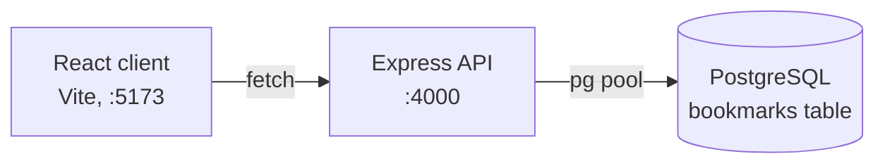

<div align="center">

# Stash

**A small personal bookmark saver: save a link with a title, see your newest first, delete what you're done with.**

[How it works](#how-it-works) &nbsp;·&nbsp; [API](#api) &nbsp;·&nbsp; [Run it](#run-it)


</div>

> [!NOTE]
> **A learning project** for hand-writing a full stack: a React client, an Express API and a Postgres table, with nothing generated. It runs locally only; there is no authentication.

## How it works



- **Client** (`client/`): a form for a URL and title, and the list of saved bookmarks, newest first, each with a delete button.
- **API** (`server/`): three routes over one table, with a health check.
- **Database:** one `bookmarks` table: `id`, `url`, `title`, optional `notes`, `tags` (a text array) and `created_at`. `npm run migrate` creates it.

## API

| Method | Path | What it does |
|---|---|---|
| `GET` | `/health` | `{ "status": "ok" }` |
| `GET` | `/api/bookmarks` | All bookmarks, newest first |
| `POST` | `/api/bookmarks` | Create one from `{ url, title, notes?, tags? }`; `url` and `title` are required (400 otherwise) |
| `DELETE` | `/api/bookmarks/:id` | Delete one (204) |

## Run it

**Prerequisites:** Node and a local PostgreSQL (for example `brew services start postgresql@17`).

```bash
git clone https://github.com/juyal-devashish/Stash.git && cd Stash
createdb stash
```

```bash
cd server
cp .env.example .env      # PORT=4000, DATABASE_URL=postgres://localhost:5432/stash
npm install
npm run migrate
npm run dev               # API on http://localhost:4000
```

```bash
cd client
npm install
npm run dev               # http://localhost:5173 (set VITE_API_URL to point elsewhere)
```

## Repository layout

```
client/   React 19 + Vite: App.jsx (form and list), api.js (fetch calls)
server/   Express 5: src/index.js, src/routes/bookmarks.js, src/db/ (pool and migration)
```

## License

[MIT](LICENSE) © 2026 Devashish Juyal
